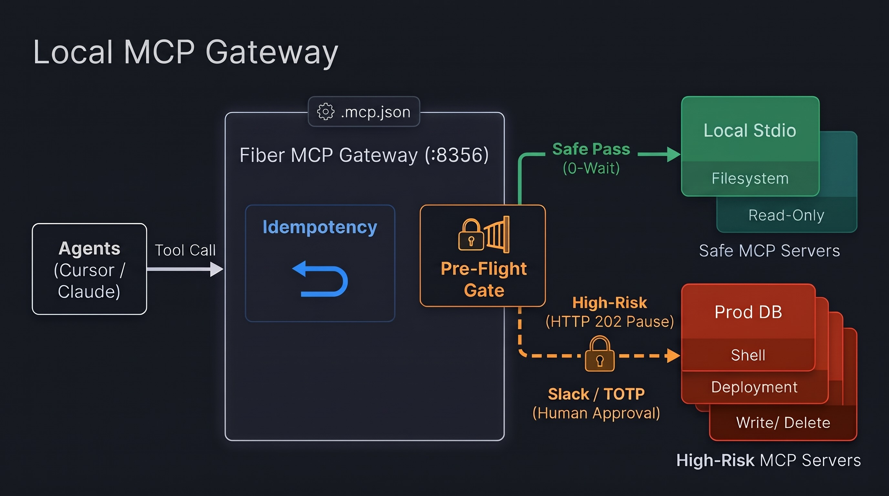
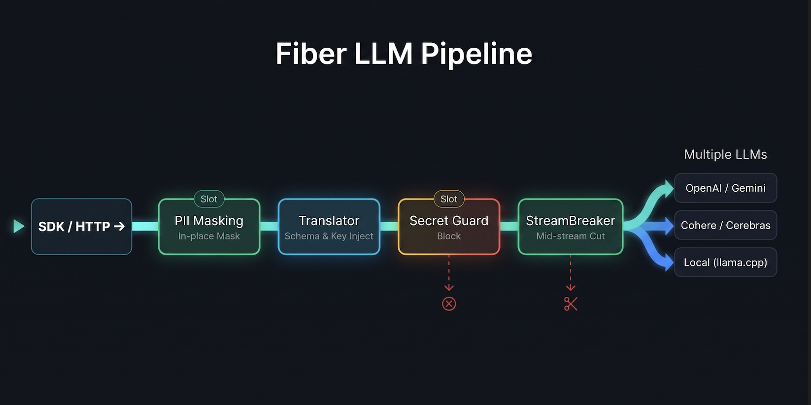

# README

Fiber is a local control plane that sits between AI agents and everything they call—tools and models alike. Your agents already run on your machine; Fiber governs every tool call and model stream they make, while they happen: routing them through one local endpoint, asking a human before risky actions, keeping secrets from leaving, cutting off runaway spend mid-stream, and replaying traffic deterministically for tests—all without changing your agent code.

Under the hood, one loopback daemon (`127.0.0.1:8356`) serves both paths: a Local MCP Gateway for tools, and an OpenAI-compatible endpoint—or an in-process Python harness—for models.

Fiber is a local-first alternative to cloud-hosted AI gateways and agent platforms: instead of routing every tool call and prompt through someone else's infrastructure, the harness runs where your agents already do. It doesn't host your agents—it governs what they touch.

**KYOC (Keep Your Own Cloud):** Fiber runs only on infrastructure you control—your machine or your own Cloudflare account. API keys resolve from your host, state stays in your local ledger, and edge workers are deployed from your machine. No shared control plane, ever.

| Section | Target Focus & Key Capabilities | Quick Jump |
| :--- | :--- | :--- |
| **1. Local MCP Gateway** | Loopback Daemon for Agents & IDEs, Pre-Flight Human Approval, Built-in Workspace Workers, Zero-Key LLM Routing | **[1.1 Gateway](#11-gateway-governance--ide-onboarding)** · **[1.2 Built-in Workers](#12-built-in-workspace-workers)** |
| **2. LLM Guardrails & Replay** | In-Flight DLP Guardrails, Mid-Stream Kill-Switch, Deterministic VCR Replay, Multi-Provider Schema Normalization | **[2.1 LLM Guardrails](#21-llm-guardrails)** · **[2.2 VCR](#22-deterministic-replay-llm-vcr--fixtures)** · **[2.3 Schema Traverser](#23-schema-traverser--compat-registry)** |
| **3. CLI & Installation** | Connect CLI, Spend Limits & Quota, Sandbox Provisioning (`uv pip`), Node Identity (`fiber init`) & Homebrew | **[3.1 Connect CLI](#31-fiber-connect-cli)** · **[3.2 Python (uv pip)](#32-python-environment-via-uv-pip-recommended-for-sdk--local-control-plane)** · **[3.3 Homebrew](#33-macos-homebrew-tap-for-local-daemon--mcp-gateway)** |
| **4. Execution Planes** | Optional Self-Hosted Edge Offload | **[4.1 Edge V8 Plane](#41-edge-v8-execution-plane)** |
| **5. Benchmarks & Validation** | Pipeline Benchmarks, End-to-End Validation Logs (HITL, Built-in Workers, Guardrail, VCR, WASM, Edge, FinOps) | **[5.1 Benchmarks](#51-pipeline-performance-benchmarks-apple-m2-32gb-ram)** · **[5.2 Validation Logs](#52-system-validation-logs)** |

---

## 0. Quick Start

```bash
uv pip install git+https://github.com/dphilabs/fiber.git@v1.1.5.0
```

**1. Boot the Local Control Plane**
Initialize your workspace, import existing IDE MCP definitions into Fiber's host registry (`~/.anchor/mcp.json`) without mutating your original IDE files, and launch the gateway daemon:

```bash
$ fiber init          # Provision workspace (~/.anchor) & local node keys
$ fiber connect all   # Non-invasively import local IDE MCP configs into ~/.anchor/mcp.json
$ fiber console       # Start gateway daemon (:8356) & Console Studio (:8357) (or `fiber daemon` for headless)
```

**2. Point External Agents & IDEs to the Gateway (Zero-Key MCP & LLM)**
Because `fiber connect` never overwrites your client files, explicitly point your IDE or agent (Claude Code, Cursor, Continue) to the loopback daemon to govern both tool calls and model streams:

```jsonc
// (A) Tool Harness — Add to your agent's MCP config (.mcp.json, .cursor/mcp.json)
{
  "mcpServers": {
    "fiber-gateway": { "url": "http://127.0.0.1:8356/v1/mcp-gateway/invoke" }
  }
}

// (B) Model Harness — Point your IDE (e.g., Continue, Cursor) or OpenAI client to :8356/v1
// Resolves host OS API keys (zero client keys) and enforces DLP guardrails by default (toggle On/Off in `fiber console`).
// apiBase: "http://127.0.0.1:8356/v1"  |  model: "cerebras/qwen-3.8-27b"
```

**3. Or Embed the In-Process Python Harness (In-Flight Guardrails & Zero-Cost `pytest` VCR)**
When building custom Python agents or CI/CD pytest suites, run the exact same DLP guardrails, stream kill-switches, and 3ms deterministic VCR replay directly in-process without a daemon:

```python
import asyncio
from fiber.llm.entry import acompletion
from fiber.llm.pipeline.interceptor.guardrail import CustomRegexMaskingGuardrail, ActiveBlockingGuardrail

async def main():
    res = await acompletion(
        model="cerebras/qwen-3.8-27b", # or openai/gpt-4o, gemini/gemini-2.5-flash, llama_server/gemma-3-1b-it-Q4_K_M.gguf
        messages=[{"role": "user", "content": "My phone is 010-1234-5678. Say 'Received'."}],
        interceptors=[
            CustomRegexMaskingGuardrail([r"\b010-\d{4}-\d{4}\b"]), # Masks PII in-place (~0.01ms)
            ActiveBlockingGuardrail(),                             # Blocks leaked API keys
        ],
        metadata={"vcr_scenario": "quickstart_demo"},              # Ready for zero-cost VCR record/replay
    )
    print(res.choices[0].message.content)

asyncio.run(main())
```

---

## 1. Local MCP Gateway

### 1.1. Gateway Governance & IDE Onboarding

The **Fiber Connect CLI** (`fiber`) is the single entrypoint for the local control plane. It registers your MCP servers and IDE configs, mounts them as managed workers under one host-local daemon, and—when needed—extends the same governance across remote nodes with zero boilerplate.

Most AI agents (Claude Code, Cursor, VSCode, Zed) launch MCP servers directly on your machine through point-to-point pipes—with your filesystem, databases, and credentials in reach, and nothing in between to absorb retries or demand approval. Fiber's **Local MCP Gateway** runs as a loopback daemon on the same host, absorbs your existing agent configurations and exposes them through a single stateless endpoint (`/v1/mcp-gateway/invoke`, `/tools`, or per-target `/v1/mcp-gateway/{target_id}/invoke`). Local stdio servers are spawned and supervised by the daemon itself, and remote HTTP/SSE servers can be registered behind the same gate—so every tool call passes through one control point on your machine.

<p align="center">
  
</p>

**Why a Local Gateway?**
Standard MCP clients treat tool calls as fire-and-forget pipes: on network timeouts, agents blindly retry or hallucinate parameters, causing duplicate database writes or runaway API charges. Fiber’s MCP Gateway interposes a single local control point between the agent and the tool—on your machine, not in a cloud relay:

  - **Idempotent Execution & Lineage**: Maps every invocation to a deterministic transaction handle backed by a local state ledger. Duplicate agent retries immediately return cached resolutions without re-executing the underlying tool, while upstream timeouts trigger automatic rollbacks.

  - **Pre-Flight Human-in-the-Loop (HITL) Approval (`HTTP 202`)**: On high-risk operations—detected either natively by the worker or zero-code prior to worker I/O via pre-flight regex traps (`--preflight`, guaranteeing Zero-I/O on persistent workers and Zero-Spawn on ephemeral sandboxes until approved)—the gateway parks the transaction via a stateless multi-round-trip yield (`YIELD` / `HTTP 202`) and awaits **human attestation** via **TOTP** (default) or **1-Click Approve/Reject buttons** (`button:<regex>`) across Slack Socket Mode, CLI, or Console Studio before resuming.

  - **Host-Local Trust Boundary**: Upstream API keys are resolved from the daemon's host environment (`.env` or OS variables) and never appear in client configs; node identity and server registry (`~/.anchor/mcp.json`) stay on the machine.

  - **Spend & Quota Limits**: Each tenant runs against a signed budget recorded in the local ledger. Budgets are versioned: stale or duplicate updates are rejected, ledger inputs can't be spent twice, and revoking a budget stops active streams.

**LLM & MCP Routing for IDEs**
Alongside the MCP endpoint, the same local daemon serves the LLM Gateway (`/v1/chat/completions`)—the HTTP face of the pipeline described in [2.1](#21-llm-guardrails).
By configuring your IDE's (e.g., Continue.dev, Cursor) API base URL to `http://127.0.0.1:8356/v1`, you can route all model requests through Fiber's guardrails. This eliminates the need to expose upstream provider API keys in client configs, as authentication is securely resolved by the daemon's host environment (`.env` files or local OS variables).

**Example: continue.dev LLM Config (config.yaml)**
By setting the client provider to `openai`, Fiber enables IDEs to seamlessly interface with models they may not natively support. Simply append the target infrastructure prefix (e.g., `cohere/`, `cerebras/`, `llama_server/`) to the model string, and Fiber handles the schema translation and OS credentials.

```yaml
models:
  # apiKey: Omitted. The daemon securely resolves KEY from its host environment.
  # Expand to Proprietary/Enterprise Models
  - name: Command R (Cohere)
    provider: openai
    model: cohere/command-r-08-2024
    apiBase: http://127.0.0.1:8356/v1

  # Ultra-Low Latency Cloud Inference
  - name: Qwen 3.8 27B (Cerebras)
    provider: openai
    model: cerebras/qwen-3.8-27b
    apiBase: http://127.0.0.1:8356/v1

  # Unified Local Execution (llama.cpp)
  - name: Gemma 3 1B (Local Engine)
    provider: openai
    model: llama_server/gemma-3-1b-it-Q4_K_M.gguf
    apiBase: http://127.0.0.1:8356/v1
```

**Agent Onboarding**
Instead of manually supervising fragmented MCP processes, Fiber explicitly scans and normalizes existing agent configs (`.mcp.json`, `.cursor/mcp.json`, `.vscode/mcp.json`) and third-party MCP servers.

To route your agent through Fiber, simply inject the `fiber-gateway` entry into your agent's configuration file (optionally attaching `FIBER_PREFLIGHT_PATTERN` in `env`—prefixed with `button:` for 1-Click Slack approval instead of default 6-digit TOTP—to lock third-party servers without modifying their code):

```json
{
  "mcpServers": {
    "fiber-gateway": {
      "url": "http://127.0.0.1:8356/v1/mcp-gateway/invoke"
    },
    "repomix": {
      "command": "npx",
      "args": ["-y", "repomix", "--mcp"],
      "env": {
        "FIBER_PREFLIGHT_PATTERN": "button:DROP|TRUNCATE|DELETE"
      }
    }
  }
}
```

**Coexistence**: Fiber's declarative mapper automatically ignores the self-referential `fiber-gateway` entry during scanning while mounting the remaining servers. Once verified, you can progressively remove redundant direct entries at your own pace.

**Declarative Provisioning (`fiber connect`)**
Rather than manually supervising background processes, `fiber connect` scans and registers your IDE configs (`.mcp.json`) and third-party servers into `~/.anchor/mcp.json` for automatic hot-reload by `fiber daemon` (see **[3.1](#31-fiber-connect-cli)** for advanced targeting and standalone sidecar modes):

```bash
# Explicitly scan & sync IDE configs (e.g., 'claude', 'cursor', or 'all') into ~/.anchor/mcp.json
$ fiber connect all

# Register & lock a 3rd-Party Stdio MCP with a 1-Click Slack Pre-Flight Guard ('button:' prefix)
$ fiber connect -t local-fs -e "npx -y @modelcontextprotocol/server-filesystem /tmp" -p "button:prod_secrets|DELETE"
```

> **Slack HITL Setup & Gateway Specs:** Provision a Socket Mode Slack app in 30s via `fiber ops channel.slack guide --open`. For the approval protocol and wire format, refer to: **[MCP Connector Spec](./xyz/spec/gateway/mcp.connector.md)** · **[Slack HITL Spec](./xyz/spec/gateway/hitl.slack.md)**

---

### 1.2. Built-in Workspace Workers

Beyond governing third-party MCP servers, Fiber ships a zero-NPM standard library of resident, multiplexed Python workers (`fiber connect builtin`). Instead of granting agents unconfined shell access or dumping whole files into context, these workers confine local data, docs, history, and media strictly to `--root`—returning bounded, structured evidence and recoverable tool errors (`isError: true`) so agents can self-correct:

| Worker | Key Tools | Workspace-Confined Purpose |
| :--- | :--- | :--- |
| **`duck`** | `describe_data`, `query_sql` | Read-only in-memory DuckDB analytics over local `.csv`/`.jsonl`/`.parquet`/`.xlsx` (`enable_external_access=false`). |
| **`reader`** | `list_modules`, `retrieve_scoped`, `compare_table` | Token-budgeted section retrieval, freshness checks, and Markdown-to-CSV/XLSX table diffing. |
| **`pin`** | `set`, `resolve`, `list`, `scope` | Persistent architectural constraints & decisions live-verified against on-disk code, docs, and Git HEAD. |
| **`verifier`** | `verify_payload`, `verify_http`, `verify_binary` | Deterministic JSON Schema, JMESPath, DPoP HTTP, and lock-safe CLI binary probes (`rules.json`). |
| **`git.history`** | `search_commits`, `blame`, `show_commit` | Lock-free (`GIT_OPTIONAL_LOCKS=0`) pickaxe commit search, line blame, and bounded patches. |
| **`mailbox`** | `search_mail`, `read_mail` | Symlink-safe, read-only search and retrieval over local `.eml` and `.mbox` archives. |
| **`media`** | `probe`, `trim`, `convert` | Non-destructive `ffprobe`/`ffmpeg` inspection and transcoding with atomic partial-file cleanup. |

```bash
# Mount all built-in workers into ~/.anchor/mcp.json (and gate mutating pins with 1-Click approval)
$fiber connect builtin$ fiber connect -t worker.memory.pin -e builtin -p "button:set|drop"
```

> **Full Tool Schemas & Isolation Rules:** **[Built-in Workers Spec](./xyz/spec/worker/builtin.md)**

---

## 2. LLM Guardrails & Replay

### 2.1. LLM Guardrails

Requests to the daemon's LLM endpoint (`/v1/chat/completions`) go through two checks before they reach the provider:

- **Masking** (`PRE_TRANSLATE`): replaces PII, sensitive headers, and URL query secrets in the request, then lets it through.
- **Blocking** (`POST_TRANSLATE`): rejects the request if it contains a credential such as an API key or private key.

Both are on by default. Turn either one off in the **Guardrail** tab of `fiber console`; the setting is saved to `~/.anchor/state.json`.

<p align="center">
  
</p>

Fiber recognizes 33 credential formats out of the box, including AWS and GCP keys, OpenAI and Anthropic keys, GitHub and Slack tokens, JWTs, and PEM private keys. To add an internal token format or disable a rule, point `FIBER_REDACT_RULES_PATH` to a `redact_rules.json` file.

The daemon also stops a response mid-stream (`StreamBreaker`) when a tenant's budget runs out or is revoked with `fiber account ... kill` (see [3.1](#31-fiber-connect-cli)).

The same guardrails and kill-switch can run inside a Python process through `acompletion(..., interceptors=[...])`. For code examples and the full rule list, see the **[Guardrail Spec](./xyz/spec/llm/guardrail.md)**. To write your own interceptor, see the **[Interceptor Spec](./xyz/spec/llm/interceptor.md)**. SDK compatibility: **[Entrypoint Spec](./xyz/spec/llm/entry.md)** · **[Token Counter Spec](./xyz/spec/llm/token.counter.md)**

---

### 2.2. Deterministic Replay (LLM VCR & Fixtures)

The exact same pipeline that guards live streams also powers offline test acceleration: Fiber's Application-Layer VCR freezes live LLM and tool traffic (requests, stream chunks, and mid-stream exceptions) into local JSON fixtures—enabling zero-cost, ~3ms deterministic `pytest` replay, chaos jitter injection, and latency emulation without altering business logic.

> **Why Fiber VCR?**
> Standard HTTP mockers (like `vcrpy`) capture raw network bytes, breaking stream timing and bloating memory. Fiber VCR operates at the LLM schema layer—coalescing SSE micro-chunks across configurable time windows (`record_tick_ms=100.0`) while preserving stream semantics.
> Because `StreamBreaker` integrates directly into the recording lifecycle, streams cut off mid-flight by a policy kill-switch or quota limit capture only pre-cutoff chunks for exact offline circuit-breaker testing.

**Per-Request HTTP Gateway & Runtime VCR**

When running `fiber daemon`, the REST Gateway (`/v1/chat/completions`) keeps the VCR proxy mounted in zero-overhead `live` passthrough mode. Any HTTP client or agent can dynamically trigger fixture recording or offline disk playback per request—without restarting the daemon—by passing `vcr` parameters in the JSON payload (or via `metadata` in `acompletion`):

```bash
# Dynamic Record: Executes live LLM call and freezes response into a local fixture
$ curl -X POST http://127.0.0.1:8356/v1/chat/completions -H "Content-Type: application/json" -d '{
    "model": "llama_server/gemma-3-1b-it-Q4_K_M.gguf",
    "messages": [{"role": "user", "content": "Give me a 3-word motto."}],
    "vcr": "record",
    "vcr_scenario": "gateway_smoke_test"
  }'

# Dynamic Replay: Replays deterministically from disk (~3ms) with zero upstream I/O
$ curl -X POST http://127.0.0.1:8356/v1/chat/completions -H "Content-Type: application/json" -d '{
    "model": "llama_server/gemma-3-1b-it-Q4_K_M.gguf",
    "messages": [{"role": "user", "content": "Give me a 3-word motto."}],
    "vcr": "replay",
    "vcr_scenario": "gateway_smoke_test",
    "vcr_speed": "max"
  }'

# Verify live HTTP Gateway roundtrip (Unary, SSE Stream, and Dynamic Record -> Replay)
$ fiber ops tester.gateway
```

**VCR Control Parameters**

The runtime resolves options per request (via JSON payload or `metadata`), environment variables, or CLI flags:

| Parameter / Flag | Accepted Values | Description |
| :--- | :--- | :--- |
| **`vcr` / `VCR_MODE`** | `"live"` \| `"record"` \| `"replay"` | Controls passthrough, upstream capture (max 5 traces), or zero-I/O disk playback. |
| **`vcr_speed` / `VCR_SPEED`** | `"max"` \| `"real"` | Immediate execution (`~0ms`) or emulated historical latency pacing (`ttfb_ms`, `delta_ms`). |
| **`vcr_chaos` / `vcr_tick`** | Float | Injects synthetic replay jitter (ms) or sets the SSE chunk coalescing window (default `100.0` ms). |

> **Pytest Suites & VCR Specifications:** For offline `pytest` cassette injection, full `VCRManager` parameter matrices, and Fixture schema, refer to: **[VCR Testing & Config Spec](./xyz/spec/llm/vcr/test.md)** · **[Fixture Format Spec](./xyz/spec/llm/vcr/fixture.format.md)**

---

### 2.3. Schema Traverser & Compat Registry

Enforcing identical in-flight guardrails (**2.1**) and deterministic VCR replay (**2.2**) across heterogeneous LLM providers requires a unified normalization boundary inside the harness. Fiber eliminates brittle `if/elif` provider parsing through its **Rule-based Traverser**—using declarative dot-notation and **Path Fallbacks** to normalize request parameters, unary responses, and async stream chunks into a single canonical schema.

**Zero-Config Defaults & Provider Extension:**
Built-in rules already normalize standard providers (`openai`, `gemini`, `cohere`, `cerebras`, `ollama`, `llama_server`) out of the box with zero configuration. When integrating a proprietary internal model or overriding existing extraction paths without modifying Python code, supply an external JSON file via the `FIBER_COMPAT_RULES_PATH` environment variable. Each rule is validated at boot; invalid rules are skipped with a warning while valid ones are merged.


```json
{
  "provider_param_rules": {
    "my_custom_llm": {
      "message_schema": "openai_array",
      "supported": ["temperature", "max_tokens", "stream"],
      "mapping": {
        "max_tokens": "max_output_tokens"
      }
    }
  },
  "extraction_rules": {
    "ollama": {
      "text": ["choices.0.delta.content", "message.content", "response", "choices.0.message.content"],
      "finish_reason": ["done_reason", "choices.0.finish_reason"],
      "is_finished_cond": {"path": "done", "value": true},
      "usage": [
        "usage",
        {"prompt_tokens": "prompt_eval_count", "completion_tokens": "eval_count"}
      ]
    },
    "gemini": {
      "text": [
        "choices.0.delta.content",
        "content.parts.0.text",
        "candidates.0.content.parts.0.text",
        "choices.0.message.content"
      ],
      "fallback_tool_name": "content.parts.0.function_call.name",
      "fallback_tool_args": "content.parts.0.function_call.args"
    }
  }
}
```

**LLM-Assisted Provider Bindings**: Because rules are declarative, even lightweight LLMs can draft new provider bindings from raw payloads—which you then verify offline with `fiber compat fixture --vcr replay`.

---

## 3. CLI & Installation

### 3.1. Fiber Connect CLI

| Command | Role | Function & Lifecycle | Example |
| --- | --- | --- | --- |
| **`init`** | **[Bootstrap]** | Initializes workspace topology (`~/.anchor/bound.json`) and local node keys. | `fiber init` |
| **`ops`** | **[Plane & Ops]** | Runs operational provisioning, channel setup, and gateway verification suites (`flare.deploy`, `channel.slack`, `tester.gateway`, `brew.verify`). | `fiber ops flare.deploy`, `fiber ops channel.slack guide --open` |
| **`console`** | **[Web Studio]** | Launches the Console Studio web UI (`MCP Gateway`, `Guardrail`, `Metering`, `VCR`, `Setting`) for HITL approvals and live telemetry. | `fiber console` |
| **`sign`** | **[Identity & TOTP]** | Inspects local node key status and manages AES-GCM encrypted Admin TOTP secrets in SQLite. | `fiber sign enroll -u fiber` |
| **`connect`** | **[Config Sync]** | Explicitly scans and registers IDE configs (`fiber connect claude`, `fiber connect all`) or third-party servers into `~/.anchor/mcp.json`. | `fiber connect all`, `fiber connect -t local-fs -e "npx -y @modelcontextprotocol/server-filesystem /tmp" -p "button:DELETE"` |
| **`connect --standalone`** | **[Standalone Sidecar]** | Runs MCP servers directly in the foreground without writing to `~/.anchor/mcp.json`. | `fiber connect --standalone -t prod-db -e "npx -y @modelcontextprotocol/server-postgres"` |
| **`daemon`** | **[Local Gateway]** | Ignites the local gateway daemon, automatically booting and hot-reloading all MCP servers registered in `~/.anchor/mcp.json`. | `fiber daemon` |
| **`compat`** | **[Compat & VCR]** | Records raw provider payloads (`record`) and verifies declarative extraction rules offline (`replay`) for schema parity. | `fiber compat fixture -m gemini/gemini-3.1-flash-lite --vcr record` |
| **`account`** | **[Spend & Quota]** | Manages tenant quotas, binds optional tenant identities, issues signed budgets, and triggers real-time stream kill-switches. | `fiber account --tenant accounting_dept --spiffe fiber jwt --usd 50 --op PROVISION --sync` |

**MCP Server Provisioning & Sidecar (`fiber connect`)**
`fiber connect` hot-reloads updated configs into `fiber daemon` (inferring transport, concurrency, and `-p` HITL guards); add option `--standalone` to run any worker as a standalone foreground sidecar:

```bash
# Explicitly scan & sync discovery configs (e.g., Claude, Cursor, or 'all') into ~/.anchor/mcp.json
$ fiber connect claude
$ fiber connect all

# Register a 3rd-Party Stdio MCP with a 1-Click Pre-Flight Guard ('button:' prefix)
$ fiber connect -t local-fs -e "npx -y @modelcontextprotocol/server-filesystem /tmp" -p "button:prod_secrets|DELETE"

# Standalone Mode: Run a worker directly in the foreground
$ fiber connect --standalone -t prod-db -e "npx -y @modelcontextprotocol/server-postgres" -p "DROP|DELETE"
```

**Node Identity & Admin TOTP (`fiber sign`)**
Inspects local node keys and enrolls administrator HITL TOTP credentials:

```bash
# Inspect local node keys, Node PubKey, and Audit
$ fiber sign status

# Enroll an administrator TOTP secret (renders terminal QR code)
$ fiber sign enroll -u fiber
```

**Spend Limits & Quota (`fiber account`)**
Records signed budgets in the local ledger and broadcasts real-time `REVOKE` kill-switches (optional `--spiffe` bindings log a non-blocking warning if unenrolled):

```bash
# Run full lifecycle walkthrough (Provision -> TopUp -> Stale Replay Check -> Revoke)
$ fiber account demo

# List all tracked local accounts and their bound SPIFFE identities from the registry
$ fiber account list

# Provision a $50 budget, bind an optional identity, and record it in the local ledger
$ fiber account --tenant accounting_dept --spiffe fiber jwt --usd 50.0 --op PROVISION --ver 1 --sync

# Trigger a Pub/Sub REVOKE kill-switch to sever active streams
$ fiber account --tenant accounting_dept kill --ver 99
```

**Console Studio**
Console Studio is a unified web console for the local daemon featuring **MCP Gateway, Guardrail, Metering, VCR, and Setting** tabs—allowing you to approve parked HITL transactions, toggle gateway `PRE_TRANSLATE` masking and `POST_TRANSLATE` blocking slots On/Off (`state.json`) alongside custom secret rules (`redact_rules.json`), monitor real-time token usage and spend, and inspect VCR fixtures. Launch with `fiber console`.

---

### 3.2. Python Environment via `uv pip` (Recommended for SDK & Local Control Plane)

- **Python**: `>= 3.12`

Best suited for full-stack integration—including the in-process Python harness (`from fiber.llm.entry import acompletion`), CLI orchestration, and local daemon deployment. We recommend using `uv pip` for deterministic dependency resolution:

```bash
## 1. Create a dedicated sandbox environment & install Fiber
mkdir -p ~/fiber-user && cd ~/fiber-user
pyenv local fiber-user

uv pip install git+https://github.com/dphilabs/fiber.git@v1.1.5.0
# OR: uv pip install -e /path/to/local/self/fiber

## Bootstrap workspace & Provision node identity
fiber init

## (Optional) Start the local gateway daemon for MCP/LLM HTTP routing & Console
fiber daemon
```

### 3.3. macOS Homebrew Tap *(For Local Daemon & MCP Gateway)*

Best suited for running Fiber as a persistent, OS-supervised background service (`fiber daemon`) to govern local AI agents via the **Local MCP & LLM Gateway** (`127.0.0.1:8356`) without manually managing Python virtual environments.

> **Isolated Runtime & Service Supervision:** The Homebrew formula provisions a dedicated Python 3.12 runtime under `libexec`, links the `fiber` CLI into your system `PATH`, and registers a `launchd` service (`keep_alive`).

```bash
## Install Fiber (auto-provisions isolated Python 3.12 runtime & embedded Valkey)
brew install dphilabs/fiber/fiber

## Bootstrap local workspace (~/.anchor) & start background services
fiber init
brew services start dphilabs/fiber/fiber

## Verify install, bootstrap, and gateway
fiber ops brew.verify
```

## 4. Execution Planes

Beyond the default host loopback runtime (`XPHI_WASM_PLANE=local`), Fiber extends its execution governance to **Cloudflare Edge V8 Isolates** for isolate-level sandbox offload.

### 4.1. Edge V8 Execution Plane

Setting `XPHI_WASM_PLANE` dynamically re-binds the execution broker to the **Edge V8 Plane** without modifying local agent or gateway logic. Fiber dispatches sandboxed compute (WASM and Python via `Pyodide`) across an HTTP/1.1 JSON-RPC bridge—enforcing runtime-enforced CPU/Wall-Time limits (`Error 1102`) and returning signed execution receipts to the local state ledger:

```bash
# Flare Local Dev Plane: Auto-provisions local Dual V8 Isolates (:8787/:8788) on demand
$ XPHI_WASM_PLANE=flare fiber daemon

# Flare Global Edge Plane: Routes directly to a self-hosted Cloudflare Worker
$ XPHI_WASM_PLANE=flare:https://xphi-gateway-node.<subdomain>.workers.dev fiber daemon
```

**Self-Hosted Provisioning**
To prevent cross-tenant state exposure and metering exhaustion, Fiber operates strictly on a Self-Hosted basis rather than routing traffic to a shared public endpoint. During provisioning, Fiber deploys two workers to your own Cloudflare account—a WASM gateway and a Python (Pyodide) engine—linked by Service Bindings.

Final state, metering, and policy always stay on your host; the edge only executes. Extension points for Cloudflare Durable Objects, D1, or Queues are available (see spec).

```bash
# Live Edge Provisioning & 3-Stage Smoke Verification (Deploys Dual Workers to Cloudflare)
$ fiber ops flare.deploy

# Verify, Inspect, or Teardown Remote Edge Workers (Reverse Dependency Order)
$ fiber ops flare.deploy teardown  # or `verify --url https://...`, `status`

# Full Local Dual-Isolate E2E Suite (23 Scenarios: Bridge Routing, Isolation & State Rollup)
$ fiber e2e infra.plane.flare --mode dev
```

| Execution Mode | `XPHI_WASM_PLANE` Binding | Target Endpoint | Architectural Role & Security Boundary |
| --- | --- | --- | --- |
| **Host Native** | `local` (Default) | Local Stream Store | Executes over native host streams and local WASM workers while anchoring the loopback control plane (`:8356`). |
| **Flare Local Dev** | `flare` or `flare:dev` | `http://127.0.0.1:8787` | Auto-spawns local Dual V8 Isolates (`:8787` Gateway / `:8788` Pyodide) on first dispatch for offline parity and E2E verification. |
| **Flare Global Edge** | `flare:https://<worker>.<subdomain>.workers.dev` | Cloudflare Global Edge | Offloads WASM/Pyodide compute to self-hosted V8 Isolates; enforces CPU/wall-time cutoffs and returns signed receipts to the local ledger; stateful bindings optional. |

---

## 5. Benchmarks & Validation

### 5.1. Pipeline Performance Benchmarks (Apple M2, 32GB RAM)

Internal overhead of the Fiber LLM pipeline, measured in VCR replay mode with 200 concurrent streams: ~1,180 req/s unary, ~2,200 chunks/s streaming, p50 <1.0ms / p95 <1.5ms routing overhead.

Method and full results: **[Validation Spec §1](./xyz/spec/validation.md#1-pipeline-performance-benchmarks-apple-m2-32gb-ram)**

### 5.2. System Validation Logs

Fiber enforces execution determinism and runtime safety through automated CI gates (on every PR and release tag) alongside reproducible `fiber e2e <suite>` validation suites across every plane:

- **MCP Gateway & Tools:** [Pre-Flight Slack HITL](./xyz/spec/validation.md#21-pre-flight-hitl-over-slack) (`gateway.hitl.slack`) · [Built-in Workspace Workers](./xyz/spec/validation.md#27-built-in-workers) (`worker.builtin`)
- **LLM Pipeline:** [In-Flight DLP Guardrails](./xyz/spec/validation.md#22-llm-guardrail) (`gateway.llm.guardrail`) · [Deterministic VCR Replay](./xyz/spec/validation.md#23-llm-vcr) (`gateway.llm.vcr`)
- **Compute & FinOps:** [Host WASM Plane](./xyz/spec/validation.md#24-host-wasm-plane-phasewasm) (`infra.wasm.phase`) · [Edge V8 Isolates](./xyz/spec/validation.md#25-edge-v8-plane) (`infra.plane.flare`) · [FinOps Kill-Switch](./xyz/spec/validation.md#26-finops-budget--kill-switch) (`inter.finops`)

Run commands, phase breakdowns, and sealed log outputs: **[Validation Spec §2](./xyz/spec/validation.md#2-system-validation-logs)**